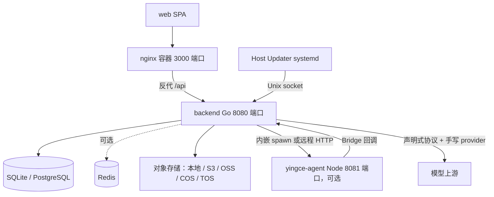
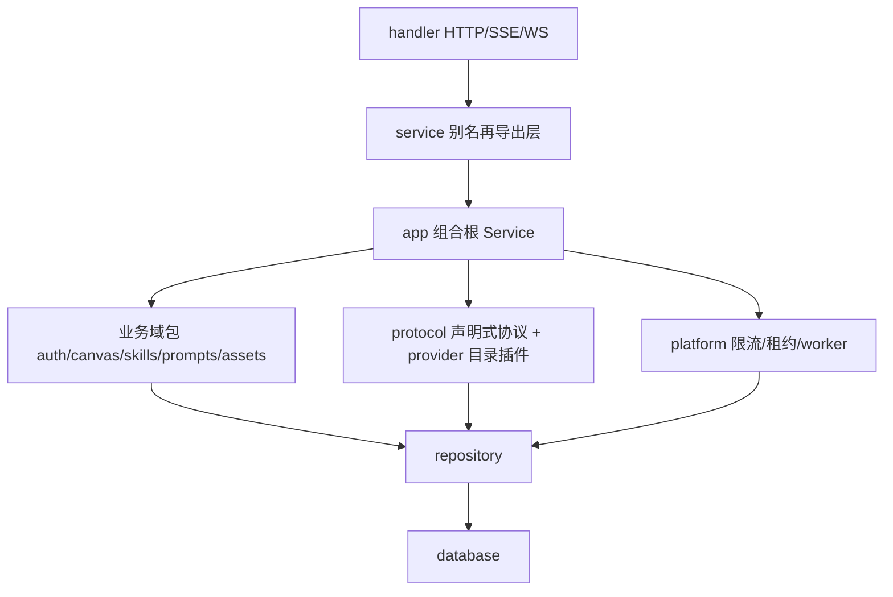
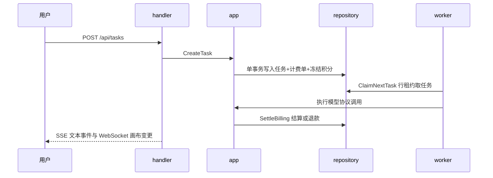

# 01 · 架构设计审计

**一句话结论**：影策是单体 Go 后端 + React SPA 前端 + 可选 Node Agent 执行器的 AI 影视创作工作台；数据库默认 SQLite、Redis 是可选协调层；没有独立消息队列——任务队列就是数据库行租约。

## 细节子页

本主文档保持概览；下钻内容由四份细节子页承载（单一事实来源，概览不复制其内容）：

- [数据流时序](details/01-data-flows.md)：六条核心链路的分步符号锚点与时序图
- [状态机与生命周期](details/01-state-lifecycle.md)：任务、计费、会话与进程四类状态转移
- [接口清单](details/01-interface-inventory.md)：路由域全集、SSE/WS 端点、中间件链
- [配置与环境变量面](details/01-config-runtime.md)：变量表与 compose 形态逐字段对照

## 进程拓扑

三种运行形态：

| 形态 | 编排文件 | 特征 |
| --- | --- | --- |
| 源码热更新开发 | `docker-compose.dev.yml` | 源码 bind 挂载，前端由 Bun 直跑 |
| 本地构建运行 | `docker-compose.yml`、`docker-compose.local.yml` | backend（SQLite）+ web 两容器 |
| 受管生产 | `docker-compose.deploy.yml`（可叠加 `browser-only` / `build`） | PostgreSQL + Redis + 一次性 migrate 服务 + yingce-agent（只读加固）+ backend + web，镜像按 digest 固定 |

另有 `docker-compose.server.yml`：源码构建 + PostgreSQL 的自托管编排，无 yingce-agent，仓库内无脚本或 CI 引用（见审计观察）。

## 后端分层

调用链合同：`HTTP → handler → service（别名层）→ app（组合根）→ 业务域包 → repository/model → database`。

两个必须先知道的现状：

- `internal/service` 只是再导出层：`aliases_*.go` 60+ 文件把 `internal/app` 的类型原样 re-export，业务实现全部在 `internal/app`（815 个文件）。
- `app.Service` 是巨石结构：60+ 字段，billing/route/worker/terminal/lifecycle 多个协调器在 `newService()`（`backend/internal/app/service.go`）单函数内手工组装。

## 关键数据流

### 生成任务（核心资金链路）

- 创建即冻结：`backend/internal/app/task_creation.go` 调 `repository/finance.go` 的 `CreateTaskWithCreditReservation`，任务、计费单、积分冻结在同一事务。
- 队列即数据库：无独立 MQ，`repository/repository_tasks.go` 的 `ClaimNextTask` 用行租约（PostgreSQL 锁行 / SQLite 条件更新）。
- 结算：`backend/internal/app/task_billing.go` 协调结算/退款；「uncertain」状态刻意保留冻结待人工核对；启动时有自动退款兜底扫描（`app/service.go`）。
- 推送：文本走 SSE（`handler/routes.go` 的 text-events，750ms 轮询回放表）；画布变更走 WebSocket（`handler/canvas_realtime.go` + `internal/canvas/realtime.go` Hub）。

### 其余关键链路

- **登录会话**：`backend/internal/handler/auth.go` → `internal/auth/auth.go` 的 Login 写 `AuthSession` 表并发随机 Token Cookie；**无 JWT**，每次请求查库验会话。
- **资源分发**：分片上传（`handler/resource_upload_session.go`）→ 对象存储适配（`internal/storage/`，本地/S3/OSS/COS/TOS）→ HMAC 签名 URL（`storage/objects.go`）。
- **渠道系统代理**：Gin `NoRoute` 兜到 `SystemProxyNoRouteHandler`（`/api/{channelId}/...`），按声明式协议白名单转发并做 SSRF 校验（`internal/outbound`）；用户自定义渠道走 `handler/custom_proxy.go` 中转。
- **模型协议**：调度与输入水合在 `app/provider.go`；声明式 manifest 协议在 `app/provider_protocol.go` + `internal/protocol/`；图片/音频手写路径在 `provider_image.go` / `provider_audio.go`；视频手写路径是遗留双轨（见审计观察）。

## 数据与运行时事实

- 数据库：默认 SQLite（WAL）；PostgreSQL 走 pgx；连接池 PG 30/10、SQLite 8/4（`backend/internal/database/database.go`）。
- 迁移：自研 checksum 迁移表，当前版本 v111（`internal/database/migrations.go`）；生产编排关闭 auto-migrate，由一次性 `migrate-schema up` 服务执行后再起 backend。
- Redis：非必需。仅用于限流/并发槽/租约/熔断与画布实时 Pub/Sub（`internal/platform/coordination.go`）；**PostgreSQL 多实例部署强制要求 REDIS_URL**。
- 并发与停机：渠道并发槽默认上限 8；优雅停机先排空 HTTP（30s）再停 worker（默认宽限 10m，`backend/cmd/server/main.go`）。
- Agent 双模式单点互斥：`backend/internal/app/cloud_agent_pi_runtime.go` —— 设了 `YINGCE_AGENT_URL` 走远程容器，否则同进程 spawn Node 子进程（`internal/agent/runtime/runtime.go`）；远程模式明确不回退内嵌，避免同一步骤跑两遍；`CANVAS_AGENT_BROWSER_ONLY=true` 时直接拒绝服务端 Node。

## 审计观察（现状事实）

1. **视频生成双轨**：`backend/internal/app/provider_video.go` 自述「遗留手写路径」，与 `internal/protocol` 声明式 manifest 并存；同类残留 `provider_jimeng.go`（即梦旧 API）、`provider_protocol_async.go`。
2. **云 Agent 双轨**：旧模型 worker 路径（`cloud_agent_runtime.go`，`legacyCloudAgentRootTask` 仅测试保留）与新 Pi 运行时（`cloud_agent_pi_*.go`）并存。
3. **别名层成本**：`internal/service` 60+ 文件纯 re-export，每加一个功能需在 app 与别名层两处同步。
4. **目录越界**：`backend/payment-plugins/`、`backend/payment-sdk/`、`backend/third_party/go-sms-sender/` 位于 backend 根目录，而非 internal 或 vendor。
5. **疑似过时编排**：`docker-compose.server.yml` 无任何脚本、CI 或代码引用；其能力被 `scripts/install-server.sh`（deploy+build 叠加）覆盖，且缺 yingce-agent 与 updater。
6. **机器绑定脚本入仓**：`scripts/launch-canvas.ps1` 硬编码本机绝对路径与公网隧道域名。
7. **单开关多点联动**：`CANVAS_AGENT_BROWSER_ONLY` 需在 deploy 编排、`scripts/install-server-image.sh`、`backend/internal/hostupdate/manager_ops.go`、`backend/internal/platform/runtime_policy.go` 四处协同维护。
8. **运营数据入仓**：`scripts/provider-catalog/` 含真实对外价格、推广期与部署状态笔记，属运维记录而非代码。
