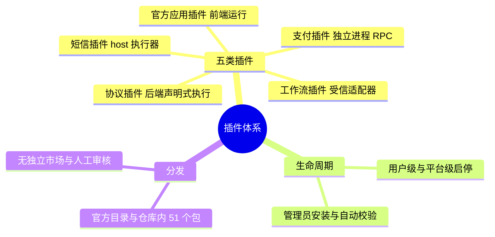
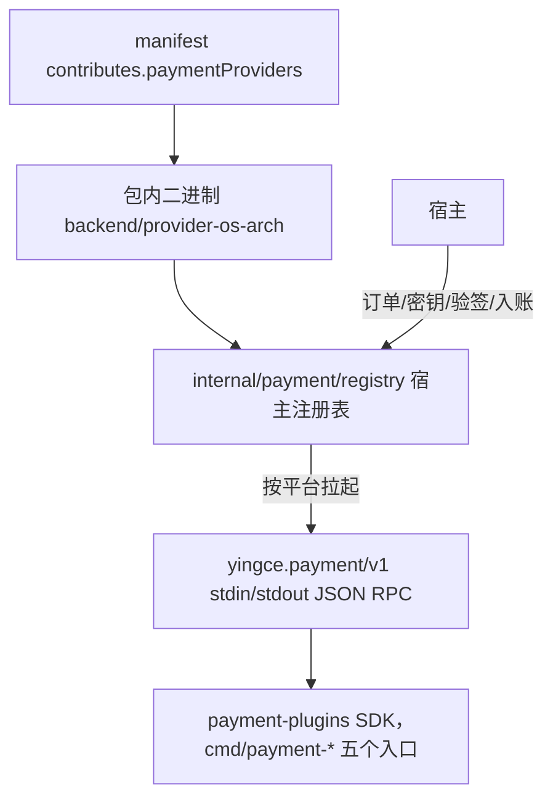

# 02 · 插件设计审计

**一句话结论**：插件体系以后端 `.yingce-plugin` 清单包（`yingce.plugin/v1`）为核心，共五类插件；支付插件是包内原生二进制、以 stdin/stdout 单次 JSON RPC 执行；所谓「支付双架构」实为前端声明层 + 后端进程执行层的互补分工，不是两套重复实现。

## 总览

## 五类插件

| 类型 | 运行位置 | 代码入口 | 宿主边界 |
| --- | --- | --- | --- |
| 协议插件（模型协议贡献） | 后端声明式执行 | `backend/internal/app/protocol_plugins.go`、`backend/internal/protocol/` | 出站 HTTP 由后端代发；上传包禁 `host:` 执行器、禁自带密钥 |
| 支付插件 | 独立进程（包内原生二进制） | `backend/internal/payment/rpc.go`、`backend/cmd/payment-*/main.go` | `yingce.payment/v1` stdin/stdout 单次 JSON RPC；订单、密钥、验签、入账全部归宿主 |
| 短信插件 | 后端进程内 `host:sms-*` 执行器 | `backend/internal/app/sms_plugins.go`、`backend/internal/sms/` | 代码内内置 manifest；凭据由短信渠道管理配置 |
| 工作流插件（RunningHub） | 后端 trusted-backend 适配器 | `backend/internal/app/workflow_plugins.go` | 执行在受信适配器内，生命周期归插件运行时 |
| 官方应用插件（eagle / 提示词优化 / 审美批改 / 媒体转换 / 用户反馈 / 官方素材库） | 前端 | `web/src/lib/plugins/builtin/` | 宿主上下文仅 storage 与 ai.text（`web/src/services/plugin-host.ts`）；后端代理路由按插件启用态门控 |

前端扩展点：清单的 `contributes.canvasNodes / assetSources`（`web/src/lib/plugins/plugin-types.ts`）向画布注册节点与素材源，权限以 `PluginPermission` 集合声明。

## 支付插件运行时

- 宿主合同：渠道实现全部来自已校验的支付插件包，声明「绝不回退到宿主内置实现」（`backend/internal/app/payment_providers.go` 头注）；上传件禁止 `host:` 执行器。
- 打包链：`backend/Dockerfile` 第一阶段构建支付插件包并做冒烟，最终镜像只带编译产物。

## 生命周期与状态

- **安装**（管理员）：`POST /api/plugins` → `RequireAdmin` → 校验包大小上限、manifest、sha256 与版本一致性，禁 `host:` 执行器（`backend/internal/handler/plugin.go`、`internal/app/protocol_plugins.go`）。
- **卸载**：`DELETE /api/plugins/:id`，并清理用户级与平台级状态表。
- **用户级启停**：`PUT /plugins/:id/activation`，仅 `ActivationScope==user` 的插件可改，状态存 `model.UserPluginState`。
- **平台级启停**：`PUT /admin/plugins/:id/availability`，`RequireAdmin` 并写审计事件，状态存 `model.PluginPlatformState`。
- **生效判定**：`platformAvailable && userEnabled`（`internal/app/plugin_management.go`），前端镜像同一判定（`web/src/stores/use-plugin-store.ts`）。

## 分发与「市场」

- 没有独立市场服务：插件中心列表 = 前端 builtin 插件 + 后端已装插件合并（`web/src/pages/plugins/index.tsx`）。
- 官方包来自 `CANVAS_OFFICIAL_PLUGIN_DIR` 目录；仓库内 `plugin-packages/` 含 51 个 `.yingce-plugin` 包。
- 「审核」是安装期自动校验（大小 / manifest / 摘要一致 / 禁 host 执行器），无人工审核流程。

## 与模型渠道体系的关系

- 自定义模型渠道**不在插件体系**：渠道配置属管理后台 channels 体系（`backend/internal/app/channel_model_catalog.go`）；浏览器侧经 `web/src/services/api/custom-channel-relay.ts` 改写到后端 `/ai/custom` 中转（`backend/internal/handler/custom_proxy.go`）。
- 两个衔接点：① 协议插件可以 `scope: user.custom-channel` 进入渠道目录（`GET /plugins/catalog`）；② Go 内部 `ModelCatalogPlugin` 接口（如百炼，`backend/internal/provider/bailian/`）按 baseURL 匹配补充模型目录——不走清单体系。

## 审计观察（现状事实）

1. **启停状态三重回退**：前端依次取 serverState → runtimeStatuses → 本地 installations（`use-plugin-store.ts`）；后端对 media-conversion / user-feedback 硬编码默认开启，注释自认「保留旧的全局启用行为」。
2. **声明了 sandbox / worker 运行时但未实现**：sandbox 画布节点渲染占位文案「插件节点等待隔离运行时」（`web/src/components/canvas/canvas-node-content.tsx`）。
3. **硬编码插件 ID 绕过注册表**：`web/src/pages/canvas/use-canvas-media-tools.ts`（1104、1399 两处）写死 `pluginId: "image-tools"`，而前端 builtin 未注册该 ID；image-tools 实际是 `plugin-packages/` 里的协议包。
4. **双分发源**：payment / workflow / sms 的 manifest 由 Go 代码内置生成（`payment_plugins.go` 等），与 `plugin-packages/` 文件包体系并存两套来源。
5. **空注册表兜底残留**：`payment_providers.go` 的 `PaymentNotificationResponseFor` 在无插件时构造空注册表返回，与「绝不回退」的声明并存。
6. **前后端双份维护官方应用 ID**：`web/src/lib/plugins/official-applications.ts` 与后端 `officialApplicationPolicies` 手工同步同一组 ID，无单一事实源。
