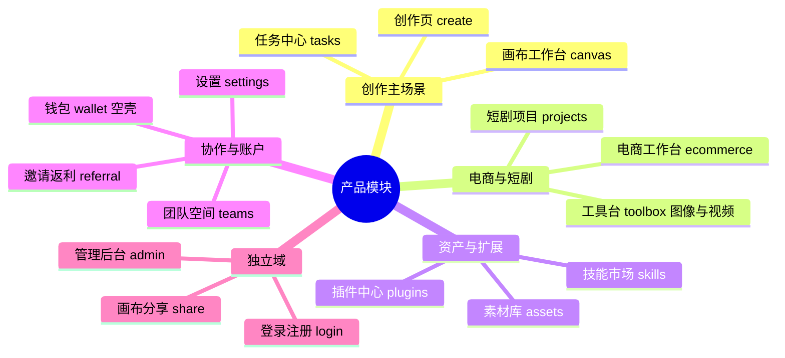

# 03 · 产品模块审计

**一句话结论**：前端约 20 个产品模块；创作画布（`/create` 与 `/canvas`）和电商工作台（`/ecommerce`）是两大主场景，短剧项目管理（`/projects`）独立成域，管理后台（`/admin`，约 40 个子路由）完全独立；存在渲染为空的死路由 `/wallet`。

## 模块全景

## 路由 → 模块映射

| 路由 | 页面（`web/src/`） | 模块定位 |
| --- | --- | --- |
| `/login` `/register` `/forgot-password` | `pages/auth/` | 登录、注册、找回密码（AuthScene 承载） |
| `/share/canvas/:token` | `pages/canvas/shared.tsx` | 画布分享页，无登录守卫 |
| `/ark-portrait/result` | `pages/ark-portrait-result` | H5 真人认证回跳页 |
| `/` 与 `/create` | `pages/create/` | 创作页（根路径即创作） |
| `/ecommerce` | `pages/ecommerce/` | 电商营销图生成工作台（约 60 文件） |
| `/toolbox/image` | `pages/workbench/image-workbench-*` | 图像工具台（功能开关门控） |
| `/toolbox/video` | `pages/workbench/video-workbench-page.tsx` | 视频工具台 |
| `/tasks` | `pages/tasks/` | 任务中心 |
| `/assets` | `pages/assets/` | 素材库 |
| `/teams` 及 `/:teamId` 下 canvas、assets、create、members、wallet 子路由 | `pages/teams/` | 团队空间（空间隔离作品与费用） |
| `/skills`、`/skills/:skillId/edit` | `pages/skills/` | 技能市场与技能工作台（管理员门控） |
| `/plugins`、`/plugins/eagle` | `pages/plugins/` | 插件中心与 Eagle 图库 |
| `/wallet` | `router.tsx` 渲染 `null` | **空壳占位**（钱包功能实际在全局钱包弹窗） |
| `/settings` | `pages/settings/` | 账户、偏好、渠道、Agent 记忆等多面板设置 |
| `/referral` | `pages/referral/` | 邀请返利 |
| `/projects`、`/projects/new`、`/:projectId`、`/:projectId/e/:episodeId` | `pages/projects/` + `studio/` | 短剧项目管理与制作 Studio |
| `/canvas`、`/canvas/:id` | `pages/canvas/` | 画布工作台（列表 + 编辑器） |
| `/admin`（约 40 个子路由） | `pages/admin/` | 管理后台独立域 |
| `/dev/*`、`/test-voice-recording` | `pages/dev/` 等 | DEV 实验路由（构建期摇树，源码常驻） |
| 其余 | `pages/not-found` | 404 |

路由定义：`web/src/router.tsx`；工作区路由分组：`web/src/lib/workspace-route-modules.ts`。

> 下钻：[路由与门控全量清单](details/03-route-inventory.md) —— 顶层路由、管理后台子路由全集、重定向清单与守卫机制。

## 核心模块展开

- **画布工作台**：产品最重的子系统，三件套分层——视图层 `web/src/components/canvas/`（232 文件：视口、节点、工具栏、previs）、状态层 `web/src/stores/canvas/`（6 个 store，主 store 872 行带持久化）、逻辑层 `web/src/lib/canvas/`（250 文件纯函数：node-registry、tool-registry、previs）。
- **电商工作台**：`web/src/pages/ecommerce/`（约 60 文件），营销图整套生成工作流。
- **短剧项目**：`web/src/pages/projects/` + `studio/`（约 35 文件），按项目与分集组织制作流程。
- **管理后台**：`web/src/pages/admin/` 覆盖渠道、逻辑模型、插件、MCP、技能、支付、日志、登录日志、邮件日志、兑换码、用户、用户组、设置、工作台工具、姿势库、分镜提示词、反馈、Agent 接入、流量等；经 `admin-page-loader` 独立懒加载，与用户端壳层隔离。

> 下钻：[核心模块数据流](details/03-module-flows.md) —— 画布生成双轨消费链、任务中心 SSE、电商与短剧流程。

## 模块间共享能力

- 素材库被画布、创作页、电商、团队空间共享（`services/` 下的 asset 同步族）。
- 模型选择与参数面板跨页复用（`components/model-picker`、`components/image-settings-panel` 等）。
- 任务中心聚合生成任务状态（`services/api/task-center.ts` + SSE 事件流）。

> 下钻：[核心模块数据流](details/03-module-flows.md) —— 模块间共享能力一节与全部共享面证据。

## 审计观察（现状事实）

1. **死路由**：`/wallet` 渲染 `null`（`web/src/router.tsx`），且被流量统计排除；钱包功能入口实际是全局钱包弹窗。
2. **DEV 实验页常驻产品源码**：`pages/dev/`（folder-preview-lab、previs-repro-lab）与 `pages/test-voice-recording.tsx` 构建期摇树，但源码位于产品页面目录。
3. **管理后台旧地址残留**：`/admin/ecommerce*` 等 6 条历史地址以 Navigate 重定向方式留在 `router.tsx`。
