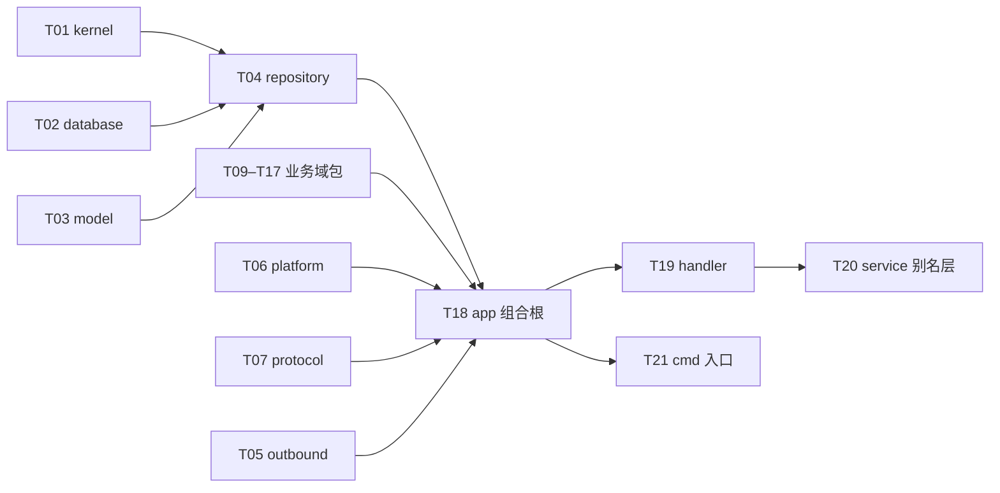
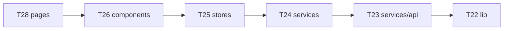

# 04 · 技术模块审计（按依赖次序编号）

**一句话结论**：后端依赖主干是 `kernel → database/model → repository → 平台与域包 → app 组合根 → handler → cmd`，前端是 `pages → components → stores → services → lib`；编号即依赖次序，被依赖者在前——审计某个行为时沿编号上行找被依赖方、下行找调用方。

## 依赖主干

箭头 = 依赖方向（谁指向谁就是谁 import 谁）。

## 后端模块（T01–T21）

| 编号 | 模块 | 路径 | 职责与审计要点 |
| --- | --- | --- | --- |
| T01 | kernel | `backend/internal/kernel` | 零依赖基元：ID、错误码、token 计费；被全库依赖 |
| T02 | database | `backend/internal/database` | 连接与连接池（PG 30/10、SQLite 8/4）、checksum 迁移（当前 v111） |
| T03 | model | `backend/internal/model` | GORM 实体与枚举；被全库依赖 |
| T04 | repository | `backend/internal/repository` | GORM 数据访问 + 计费/租约事务（任务入队即 `CreateTaskWithCreditReservation` 单事务） |
| T05 | outbound | `backend/internal/outbound` | 出站 SSRF 防护、代理与 URL 校验；所有模型上游出站的闸门 |
| T06 | platform | `backend/internal/platform` | 限流、并发槽（默认上限 8）、租约、熔断（Redis 或本地回退）+ worker 运行时；PG 多实例强制 REDIS_URL |
| T07 | protocol | `backend/internal/protocol` | 声明式 JSON manifest 协议适配（内置 + 插件），模型协议的统一执行面 |
| T08 | provider | `backend/internal/provider` | 厂商模型目录插件接口（`ModelCatalogPlugin`，如 bailian 按 baseURL 补目录） |
| T09 | assets | `backend/internal/assets` | 资源引用快照、访问控制、URL 解析 |
| T10 | auth | `backend/internal/auth` | 登录会话（DB 会话，无 JWT）、注册、OIDC、微信、邮箱、Turnstile |
| T11 | skills | `backend/internal/skills` | 技能库、内置技能、skill 包（GitHub 拉取）与鉴权 |
| T12 | prompts | `backend/internal/prompts` | 提示词模板、Agent 策略、风格档案 |
| T13 | canvas | `backend/internal/canvas` | 画布文档、布局与实时协作 Hub（Redis Pub/Sub + 设备号 Lua） |
| T14 | storage | `backend/internal/storage` | 对象存储适配（本地/S3/OSS/COS/TOS）+ 签名 URL |
| T15 | payment | `backend/internal/payment` + `backend/payment-plugins/` + `backend/payment-sdk/` | 支付宿主注册表、`yingce.payment/v1` RPC 合同、provider SDK；后两层在 backend 根目录（目录越界，见 01 审计观察） |
| T16 | agent | `backend/internal/agent/` | `runtime/`（内嵌 spawn pi 子进程 + Bridge 回调服务）与 `yingceagent/`（远程 HTTP 客户端）；互斥点在 `app/cloud_agent_pi_runtime.go` |
| T17 | 集成域 | `backend/internal/{sms,emailidentity,integrations,tools,workbench,ecommerce*,jianying}` | 短信渠道、邮件身份、MCP/飞书集成、内置工具、工作台目录、电商域、剪映对接 |
| T18 | app | `backend/internal/app` | 组合根与全部业务编排：任务创建/计费协调/worker/系统代理/云 Agent Pi/插件运行时；Service 巨石（60+ 字段、815 文件、多协调器单函数组装） |
| T19 | handler | `backend/internal/handler` | HTTP 路由、中间件、SSE、WebSocket、OpenAPI、系统代理；不含业务判断 |
| T20 | service | `backend/internal/service` | 纯别名再导出层（24 个 aliases_*.go 文件），对 handler/cmd 的稳定导入面；每加功能需两处同步 |
| T21 | cmd | `backend/cmd/` | 可执行入口：`server`、`migrate-schema`、`migrate-sqlite-postgres`、`payment-*`（5 个）、`host-updater` |

> 下钻：[后端模块细节卡](details/04-backend-modules.md) —— T01–T21 每卡符号、装配顺序与边界事实。

## 前端模块（T22–T28）

| 编号 | 模块 | 路径 | 职责与审计要点 |
| --- | --- | --- | --- |
| T22 | lib | `web/src/lib` | 纯函数与协议转换：`lib/canvas`（250 文件画布算法）、`model-protocols`、`art-critique`、`plugins`（插件类型与 builtin 注册） |
| T23 | services/api | `web/src/services/api` | 唯一 HTTP 边界：`request.ts` 信封与 ApiError + 93 个 API 模块；渠道传输（`custom-channel-relay.ts`、`channel-transport.ts`）；image/video/audio 协议组包；`task-text-stream.ts` SSE 解析 |
| T24 | services | `web/src/services` | 跨页副作用：媒体缓存、画布同步（realtime + polling + mutation batches + edit leases）、生成副作用族、agent 服务族 |
| T25 | stores | `web/src/stores` | zustand：根 20+ store（用户/配置/模型目录/插件/外观等）+ `canvas/` 6 store（主 store 872 行带持久化） |
| T26 | components | `web/src/components` | 跨页复用组件 52 项；`canvas/` 232 文件为最大子域（视口、节点、工具栏、previs） |
| T27 | 壳与装配 | `web/src/layouts`、`web/src/router.tsx`、`web/src/application.tsx` | 路由级布局、全局浮层、应用装配 |
| T28 | pages | `web/src/pages` | 路由页面；`admin/` 独立域经 `admin-page-loader` 懒加载（模块清单见 03） |

> 下钻：[前端与横切模块卡](details/04-frontend-cross-modules.md) —— T22–T32 细节卡与反向耦合证据清单。

## 横切模块（T29–T32）

| 编号 | 模块 | 路径 | 职责与审计要点 |
| --- | --- | --- | --- |
| T29 | Agent 运行时 | `backend/agent-runtime/pi` | Node 单次运行 CLI：stdin 读 JSON 请求，驱动 pi SDK 执行一轮 Agent 步骤，stdout 逐行输出事件；模型/工具调用经 Bridge 回调 Go 侧 |
| T30 | 远程 Agent 容器 | `yingce-agent/` | 独立 HTTP 服务：鉴权、并发闸门（`MAX_CONCURRENT_SESSIONS`）、孤儿目录回收；健康检查 `/healthz` |
| T31 | 部署编排 | 根 `Dockerfile`、`backend/Dockerfile`、`yingce-agent/Dockerfile`、`nginx.conf`、7 个 `docker-compose*.yml` | web 镜像 = nginx 托管 SPA + `/api` 反代（SSE 关缓冲）；backend 镜像 = 三个 Go 二进制 + pi node_modules + ffmpeg；compose 家族职责见 01 |
| T32 | 工具链 | `scripts/` | 安装轨（`install-server-image.sh` 镜像版 / `install-server.sh` 源码版 / `install-host-updater.sh`）、推送前验证（`verify-before-push.mjs`）、docs 自检（`check-docs-index.mjs`）、本地启动（`start-local.ps1` 等） |

> 下钻：[前端与横切模块卡](details/04-frontend-cross-modules.md) —— 横切四卡与全部反向耦合证据。

## 前端依赖方向核查

主方向 `pages → components → stores → services → lib` 成立，但存在反向耦合（审计要点）：

- **services ↔ stores 双向耦合**：`api/image.ts`、`api/video.ts`、`api/audio.ts`、`channel-transport.ts` 等 40+ 文件 import `stores/use-config-store`（读取模型请求配置），是反向依赖最重的一条。
- **components → pages 越层**（3 处）：`components/canvas/canvas-cloud-agent-settings.tsx`、`canvas-workspace-panel.tsx`、`canvas-workspace-personal-asset-preview.tsx` 分别 import pages/settings、pages/canvas、pages/assets 下的模块。
- **lib → services 运行时依赖**（2 处）：`lib/art-critique/` 的 pipeline 与 review 调用 `services/api/image`；`lib/canvas/agent-error-presentation.ts` 依赖 ApiError。

## 双轨与残留（跨模块观察）

- **生成双轨**：浏览器直连上游协议（`api/image.ts` / `video.ts` / `audio.ts`）与后端任务制（`api/generation-task.ts`）并存，由调用方（画布生成、创作页 runtime）自行选择轨道。
- **画布同步三轨并存**：`canvas-realtime(-client).ts`（实时订阅）+ `canvas-sync-polling.ts`（轮询）+ `canvas-mutation-batches.ts` / `canvas-edit-leases.ts`（写侧协调）。
- **两套懒加载机制**：路由侧 `preloadableLazy`（`lib/preloadable-lazy.ts`）与管理后台 `lazyAdminPage` 并行。
- **样式双份**：`styles/globals.css` 与 `styles/globals-2.css` 同时定义 `.workflow-test-workbench` 等同名选择器。
