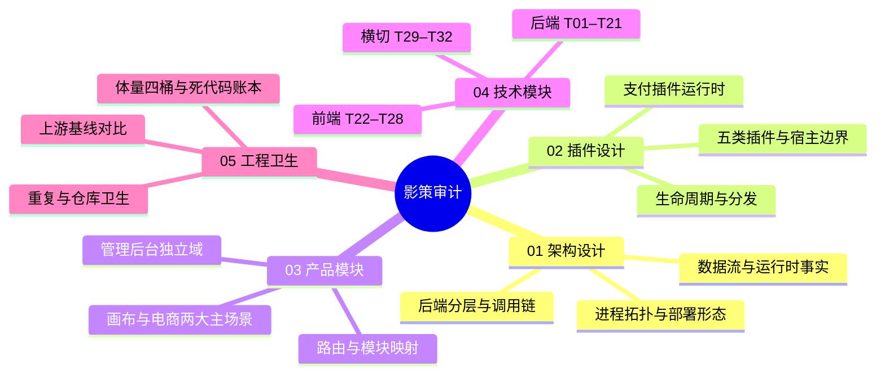

# 影策 · 项目审计文档

本目录是对影策（`ddcat-ai/open-ai-canvas`）的独立人类审计文档：四份文档全部从当前代码实地梳理，每条结论附代码路径作为证据锚点，可直接进代码核对。与仓库 `docs/`（历史专题文档集）相互独立——不引用、不依赖，`docs/` 中的提案与调研内容不作为本审计的依据；两者结论冲突时，以代码为准。

正文中代码路径均相对仓库根目录。

## 总览

## 文档次序

| 文档 | 回答的问题 | 一句话定位 |
| --- | --- | --- |
| [01 架构设计](01-architecture.md) | 系统由什么组成、怎么跑起来 | 单体 Go 后端 + React SPA + 可选 Node Agent；无独立消息队列，任务队列即数据库行租约 |
| [02 插件设计](02-plugins.md) | 扩展能力如何注册、执行、管控 | 以 `.yingce-plugin` 清单包为核心；支付插件是包内原生二进制，走 stdin/stdout JSON RPC |
| [03 产品模块](03-product-modules.md) | 用户能看到哪些功能、在哪个路由 | 创作画布与电商工作台是两大主场景，管理后台约 40 个子路由独立成域 |
| [04 技术模块](04-tech-modules.md) | 代码按什么依赖次序组织 | 编号即依赖次序（被依赖者在前），从 kernel 到 pages 共 32 个模块 |
| [05 工程卫生](05-engineering-hygiene.md) | 债现在哪里、有多少 | 死代码账本（前端 45 文件 35.4k 行、Go 275 函数）、重复 17.9k 行、git 内约 190MB 编译产物；全部实测可复验 |

审计建议次序：先读 01 建立全局图，再按 04 的编号定位模块，02 与 03 按需下钻，05 给出可对账的债务基线。

## 审计约定

- **审计基线**：本目录结论基于 main `cdff5336`（2026-11-27）实测。代码持续演进，05 的账本类数字随 HEAD 漂移，处置前按其复现命令重测。
- **证据锚点**：正文中的代码路径即审计证据；标注行号的结论可打开文件直接核对。
- **审计观察不是待办**：各文档末尾的「审计观察」只陈述代码中可见的现状事实（双轨、残留、越界），不含承诺与排期。
- **不覆盖范围**：本审计不含性能评估、测试质量评估与 UI 视觉审计；05 只量化现状，不构成整改排期。
- **抽查方法**：任选一条结论，按路径打开对应文件核对；双轨与残留类结论建议同时核对两处代码的存在性。
- **细节子页**：已深化的主文档在 `details/` 下配有细节子页，入口见各主文档的下钻链接；索引自检（`bun scripts/check-docs-index.mjs`）同时覆盖 docs 与 audit 两域。
