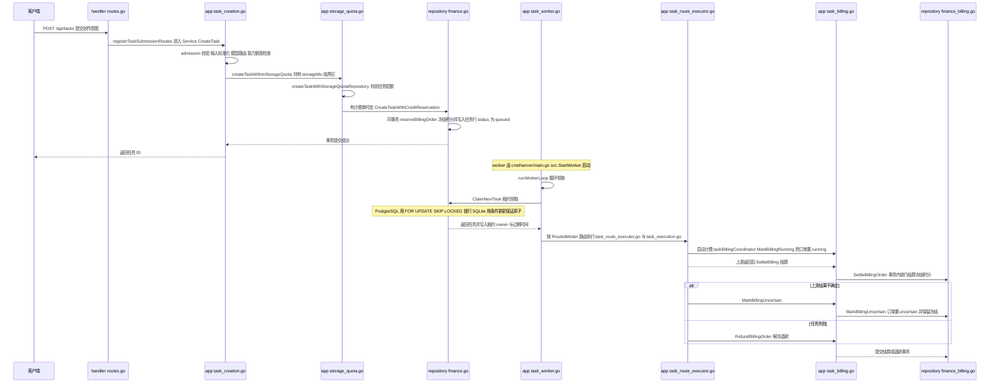
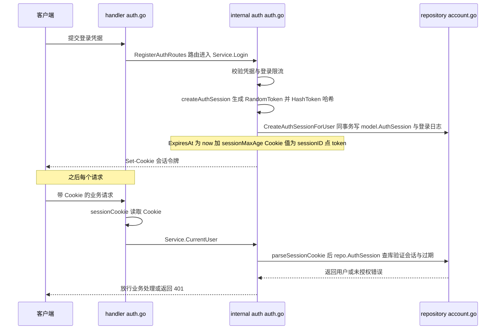
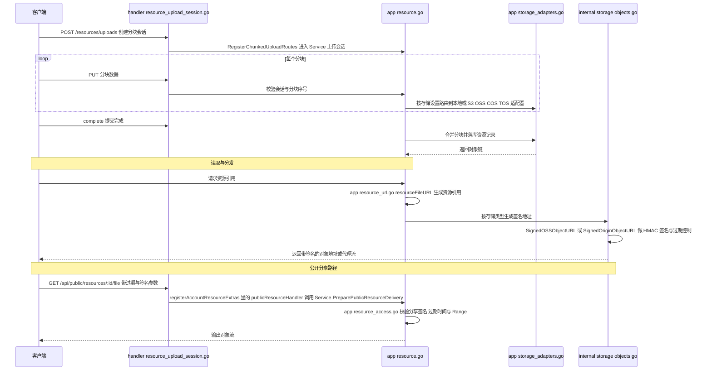
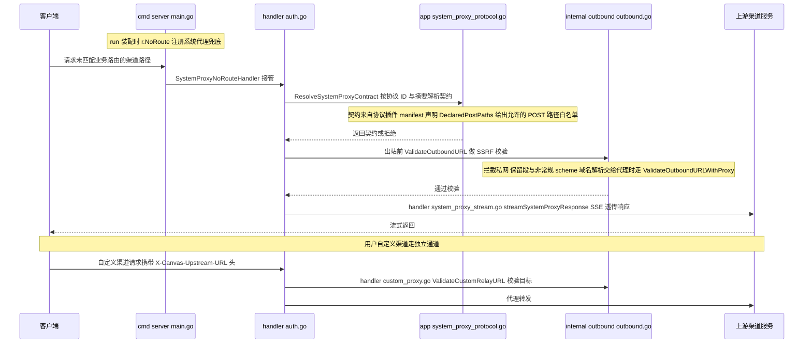
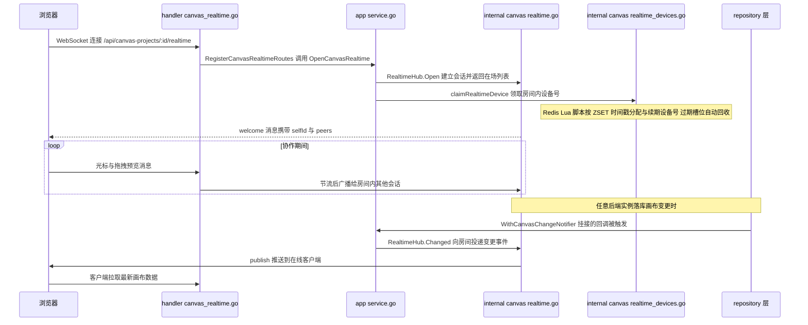
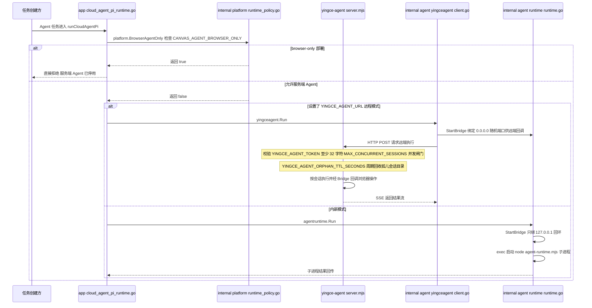

# 关键数据流时序

本页按六条关键链路给出后端数据流时序图与分步符号锚点，全部符号均经代码抽查核实；路径以仓库根为基准。

## 链路一：生成任务（含资金链）

一次生成任务从提交到结算横跨「创建入队 → 冻结积分 → worker 领取 → 执行 → 结算/退款 → 推送」六段。任务与计费单在同一个数据库事务里落库，保证「有任务必有冻结单、有冻结单必有任务」。

分步锚点：

1. 提交入口：`backend/internal/handler/routes.go` `registerTaskSubmissionRoutes` 注册 `r.POST("/tasks", submit)`；客户端只提交创作意图，模型、渠道、协议与计价全部由服务端目录重新解析。
2. 准入：`backend/internal/app/task_creation.go` `Service.CreateTask` 做输入标准化、`requireTaskGenerationFeatures` 能力校验、逻辑模型路由；Agent 类任务在此被强制走专用接口。任务对象创建时即 `Status` 为 queued、`Stage` 为 等待队列调度。
3. 配额与持久化：`backend/internal/app/storage_quota.go` `createTaskWithinStorageQuota` 在 `storageMu` 临界区内调用 `createTaskWithStorageQuotaRepository`，先 `validateTaskStorageQuotaWithPolicy` 校验任务条数与数据量配额，再交给仓储层。
4. 资金事务：`backend/internal/repository/finance.go` `CreateTaskWithCreditReservation` 在同一事务内依次做 `enforceAgentRunLimit` 并发上限、`requireExclusiveCanvasAgent` 画布 Agent 互斥、`requireActiveLogicalModelForTask` 模型有效性、`enforceActiveTaskLimit`，然后 `reserveBillingOrder` 冻结积分、写入任务行。无计费单的任务走 `CreateTaskWithActiveLimit`。
5. worker 启动与领取：`backend/cmd/server/main.go` `run` 中调用 `svc.StartWorker`（实现在 `backend/internal/app/service.go` `StartWorker`）；`backend/internal/app/task_worker.go` `runWorkerLoop` 循环调用 `backend/internal/repository/repository_tasks.go` `ClaimNextTask`，PostgreSQL 走 `FOR UPDATE SKIP LOCKED` 锁行，SQLite 走条件更新；领取会写入 `lease_owner` 与 `lease_expires_at`，租约过期可被重新领取，旧执行者的迟到写入因租约不匹配被丢弃。
6. 执行：`backend/internal/app/task_route_executor.go` 与 `backend/internal/app/task_execution.go` 按 `RoutedModel` 调用上游 Provider，期间带租约校验写回进度。
7. 结算：`backend/internal/app/task_billing.go` `taskBillingCoordinator` 的 `MarkBillingRunning`、`SettleBilling`、`MarkBillingUncertain` 调用 `backend/internal/repository/finance_billing.go` 的 `MarkBillingRunning`、`settleBillingOrder`（`SettleBillingOrder` 入口）、`refundBillingOrder`（`RefundBillingOrder` 入口）、`MarkBillingUncertain`；结算与退款均在 `lockTeamForBilling` 加行锁的事务内完成。
8. 推送（文本链）：`backend/internal/handler/routes.go` `streamTaskTextEvents` 以 SSE 回放文本增量，内部 `pollTicker` 为 750 毫秒轮询、`heartbeatTicker` 为 15 秒心跳，按 `after` 游标回放表内增量。
9. 推送（画布变更链）：`backend/internal/handler/canvas_realtime.go` `RegisterCanvasRealtimeRoutes` 提供 WebSocket；服务端落库后经 `backend/internal/repository/canvas_change_notifications.go` `WithCanvasChangeNotifier` 通知 `backend/internal/canvas/realtime.go` `RealtimeHub.Changed` 分发给房间内会话。

## 链路二：登录会话

登录建立无 JWT 的服务端会话：随机 Token 只出现在 Cookie，数据库只存哈希；此后每个请求都查库验证会话。

分步锚点：

1. 路由：`backend/internal/handler/auth.go` `RegisterAuthRoutes`；请求侧读 Cookie 的 `sessionCookie` 与 `currentUser` 也在该文件。
2. 登录：`backend/internal/auth/auth.go` `Login` 成功后调用 `createAuthSession`：`RandomToken` 生成随机令牌、`HashToken` 做 SHA-256 哈希入库，`ExpiresAt` 按 `sessionMaxAge` 计算，经 `backend/internal/repository/account.go` `CreateAuthSessionForUser` 与登录日志同事务写入 `model.AuthSession`。
3. 每请求验证：`backend/internal/auth/auth.go` `CurrentUser` 先 `parseSessionCookie` 拆出会话 ID 与令牌，再查 `repo.AuthSession` 比对哈希与过期时间；无 JWT、无内存态，重启不丢会话。
4. 登出：`Logout` 走 `backend/internal/repository/login_logs.go` `RevokeAuthSessionWithLog` 撤销会话并记日志。

## 链路三：资源上传与签名分发

分块上传把对象写入可插拔存储适配器；读取时按存储配置选择直连或 HMAC 签名 URL，公开分享走带过期与签名的专用分发路径。

分步锚点：

1. 上传：`backend/internal/handler/resource_upload_session.go` `RegisterChunkedUploadRoutes` 串起创建会话、PUT 分块、complete 合并三步。
2. 存储：`backend/internal/app/resource.go` 编排上传会话；`backend/internal/app/storage_adapters.go` 提供本地、S3、OSS、COS、TOS 适配。
3. 引用与签名：`backend/internal/app/resource_url.go` `resourceFileURL` 等函数负责资源引用与解析；`backend/internal/storage/objects.go` `SignedOSSObjectURL` 与 `SignedOriginObjectURL` 做 HMAC 签名 URL，带过期时间。
4. 公开分享：`backend/internal/handler/user_data.go` `registerAccountResourceExtras` 注册 `/api/public/resources/:id/file` 路由，`publicResourceHandler` 调用 `backend/internal/app/resource_access.go` `Service.PreparePublicResourceDelivery` 校验 expires 与 signature 后输出对象流。

## 链路四：渠道系统代理

系统代理挂在 gin 的 NoRoute 上：凡未匹配业务路由的 `/api/{渠道标识}/...` 请求，按模型协议解析白名单契约，经 SSRF 校验后透传上游。

分步锚点：

1. 注册：`backend/cmd/server/main.go` `run` 中 `r.NoRoute(handler.SystemProxyNoRouteHandler(svc))`。
2. 接管：`backend/internal/handler/auth.go` `SystemProxyNoRouteHandler`。
3. 契约：`backend/internal/app/system_proxy_protocol.go` `ResolveSystemProxyContract` 经 `selectModelRelease` 选定协议插件发布版，`DeclaredPostPaths` 从插件 manifest 声明中提取允许的 POST 路径白名单；内置协议沿用宿主自身合同。
4. 透传：`backend/internal/handler/system_proxy_stream.go` `streamSystemProxyResponse` 做流式回写。
5. SSRF：`backend/internal/outbound/outbound.go` `ValidateOutboundURL` 校验出站目标，私网与保留网段默认拦截；经渠道代理出站时改走 `ValidateOutboundURLWithProxy`，域名解析交由代理完成。
6. 自定义渠道：`backend/internal/handler/custom_proxy.go` 读取 `X-Canvas-Upstream-URL` 头并经 `ValidateCustomRelayURL` 校验后转发。

## 链路五：画布实时协作

画布协作由进程内 Hub 加 Redis 两层组成：房间与会话在本地 Hub，设备号与跨实例共识在 Redis Lua；仓库层写路径通过通知回调把变更推给在线房间。

分步锚点：

1. Hub：`backend/internal/canvas/realtime.go` `RealtimeHub`、`NewRealtimeHub`、`Open`、`Changed`、`deliver`、`publish`；有 Redis 时跨实例广播，无 Redis 时退化为进程内。
2. 设备号：`backend/internal/canvas/realtime_devices.go` `claimRealtimeDevice` 与 `renewRealtimeDevice` 两个 Redis Lua 脚本，用 ZSET 过期时间戳分配与续期，崩溃残留槽位自动回收。
3. 挂接：`backend/internal/app/service.go` `newService` 组装时执行 `repo.WithCanvasChangeNotifier(canvasRealtime.Changed)`，仓储层落库后回调 Hub。
4. 入口：`backend/internal/handler/canvas_realtime.go` `RegisterCanvasRealtimeRoutes` 注册 `GET /api/canvas-projects/:id/realtime`，用 `websocket.Accept` 升级连接并下发 welcome 与 peers。

## 链路六：Agent 双模式单点互斥

服务端 Agent 有远程托管与内嵌进程两种模式，由环境变量在运行时二选一；browser-only 部署直接在入口拒绝服务端 Agent。画布维度通过仓库层互斥保证单点执行。

分步锚点：

1. 分叉点：`backend/internal/app/cloud_agent_pi_runtime.go` `runCloudAgentPi`，先查 `platform.BrowserAgentOnly()`，再按 `YINGCE_AGENT_URL` 环境变量选择远程或内嵌。
2. browser-only 闸门：`backend/internal/platform/runtime_policy.go` `BrowserAgentOnly` 读取 `CANVAS_AGENT_BROWSER_ONLY`，为 true 时服务端 Node Agent 在入口被拒绝。
3. 远程模式：`backend/internal/agent/yingceagent/client.go` `Run`，Bridge 经 `agentruntime.StartBridge("0.0.0.0:0", bridgeHost)` 对远端可达，任务本体 HTTP POST 到 `YINGCE_AGENT_URL`。
4. 内嵌模式：`backend/internal/agent/runtime/runtime.go` `Run`，Bridge 只绑 `127.0.0.1`，随后 `exec` 启动 `node agent-runtime.mjs` 子进程。
5. 远端对端：`yingce-agent/server.mjs` 校验 `YINGCE_AGENT_TOKEN`（至少 32 字符）、以 `MAX_CONCURRENT_SESSIONS` 限制并发会话、按 `YINGCE_AGENT_ORPHAN_TTL_SECONDS` 回收孤儿会话目录。
6. 单点互斥：`backend/internal/repository/finance.go` `CreateTaskWithCreditReservation` 内 `requireExclusiveCanvasAgent` 在画布维度保证同一画布 Agent 任务互斥。
