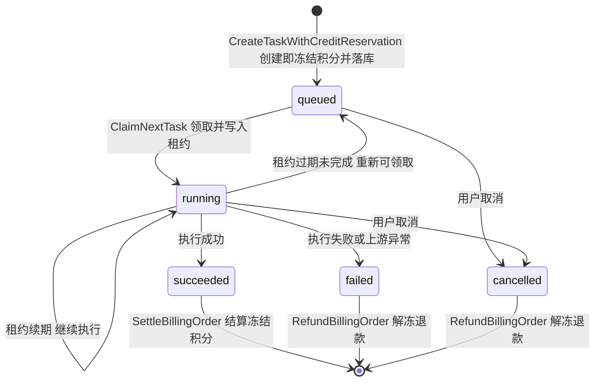
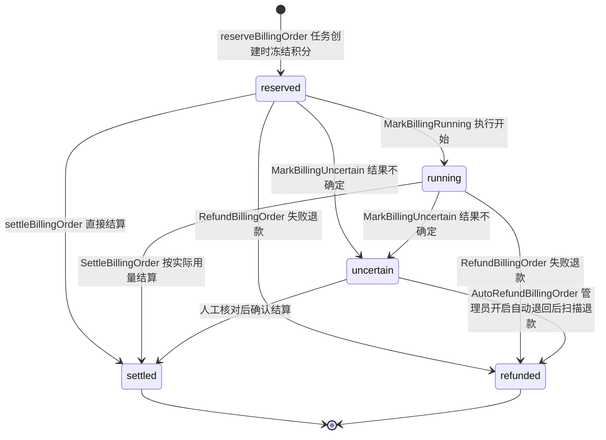
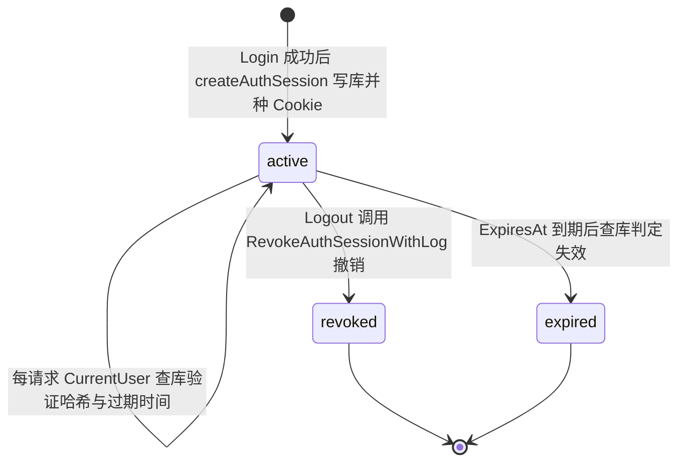
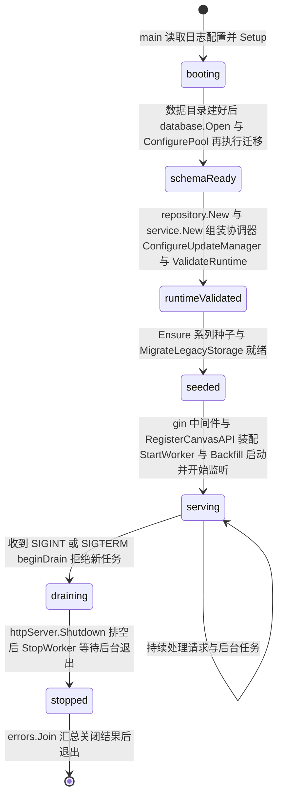

# 状态机与生命周期

本页梳理四类核心状态机与生命周期：任务状态机、计费单状态转移、登录会话生命周期与后端进程生命周期，符号均经代码抽查核实。

## 一、任务状态机

任务状态定义在 `backend/internal/model/models.go` 的 `TaskStatus`：queued、running、succeeded、failed、cancelled。任务创建即冻结积分并入队，worker 以数据库租约领取，租约过期可被重新领取，终态结算或退款。

状态转移锚点：

- 创建即冻结：`backend/internal/app/task_creation.go` `Service.CreateTask` 构造任务时 `Status` 即为 queued、`Stage` 为 等待队列调度；随后 `backend/internal/app/storage_quota.go` `createTaskWithStorageQuotaRepository` 调用 `backend/internal/repository/finance.go` `CreateTaskWithCreditReservation`，在同一事务里 `reserveBillingOrder` 冻结积分并写任务行。
- 领取租约：`backend/internal/repository/repository_tasks.go` `ClaimNextTask` 按 `created_at` 升序领取 queued 任务或租约过期的 running 任务；PostgreSQL 用 `FOR UPDATE SKIP LOCKED` 锁行，SQLite 用条件更新。所有执行中写入带 `taskLeaseWriter` 租约校验，旧执行者迟到写入被丢弃。
- 终态与账务联动：成功走 `backend/internal/repository/finance_billing.go` `settleBillingOrder` 扣除冻结；失败与取消走 `refundBillingOrder` 解冻。
- 排空保护：`backend/internal/app/task_creation.go` `Service.CreateTask` 开头检查 `IsDraining`，进程进入停机排空后拒绝新任务。

## 二、计费单状态转移

计费单状态定义在 `backend/internal/model/models.go` 的 `BillingStatus`：reserved、running、settled、refunded、uncertain。uncertain 是刻意设计的安全态：保留冻结积分等待人工核对，绝不自动结算。

状态转移锚点：

- 冻结创建：`backend/internal/repository/finance_billing.go` `reserveBillingOrder`，随 `CreateTaskWithCreditReservation` 同事务提交。
- 进入 running：`backend/internal/repository/finance_billing.go` `MarkBillingRunning` 带条件更新 `status 为 reserved 才置 running`，否则返回 `ErrBillingStateConflict`；入口在 `backend/internal/app/task_billing.go` `taskBillingCoordinator` 的 `MarkBillingRunning`。
- 结算：`backend/internal/repository/finance_billing.go` `SettleBillingOrder` 内部 `settleBillingOrder` 在 `lockTeamForBilling` 加锁的事务里按观测用量结算，幂等：已 settled 直接返回；`RecordBillingResolution` 可记录人工核对结论。
- uncertain 语义：`backend/internal/repository/finance_billing.go` `MarkBillingUncertain` 源码注释明确「uncertain 保留冻结积分，直到人工核对；这里故意不自动结算或退款」，条件更新允许从 reserved 或 running 进入，入口在 `backend/internal/app/task_billing.go` `MarkBillingUncertain`。
- 自动退回兑底：`backend/internal/app/service.go` `newService` 启动时经 `startBillingAutoRefundWorker` 挂起 `backend/internal/app/billing_auto_refund.go` 的 `billingAutoRefundScan` 后台扫描，每分钟一轮；但受管理员开关 `BillingAutoRefundSetting` 控制，默认关闭——只有管理员明确开启后 `autoRefundReviewBilling` 才扫描 uncertain 订单，并经 `backend/internal/repository/finance_billing.go` `AutoRefundBillingOrder` 重新复核候选后退款，避免扫描后任务重试或作品落库仍被误退。

## 三、会话生命周期

会话不是 JWT：数据库持 `model.AuthSession`，Cookie 只携带 `sessionID.token`，数据库存令牌哈希；每个请求查库验证，登出或过期即失效。

状态转移锚点：

- 创建：`backend/internal/auth/auth.go` `createAuthSession`，`RandomToken` 生成随机令牌、`HashToken` 做 SHA-256 哈希，`ExpiresAt` 为当前时间加 `sessionMaxAge`，经 `backend/internal/repository/account.go` `CreateAuthSessionForUser` 与登录日志同事务写入；密码、LinuxDO、OIDC、微信、验证码等登录路径全部收敛到该函数。
- 每请求验证：`backend/internal/handler/auth.go` `sessionCookie` 读 Cookie，`backend/internal/auth/auth.go` `CurrentUser` 先 `parseSessionCookie` 再查 `repo.AuthSession` 比对哈希与过期时间；伪造令牌哈希不匹配只会拒绝该请求，不会波及同账号有效会话。
- 失效：`backend/internal/auth/auth.go` `Logout` 与 `LogoutForExpectedUser` 经 `backend/internal/repository/login_logs.go` `RevokeAuthSessionWithLog` 撤销会话并落登录日志；过期会话在查库时被 `ExpiresAt` 判定拒绝。

## 四、后端进程生命周期

进程装配与停机全部收敛在 `backend/cmd/server/main.go` 的 `run` 函数；停机先排空 HTTP 再等后台任务，宽限期由 `CANVAS_SHUTDOWN_TIMEOUT` 控制，默认 10 分钟。

生命周期锚点（按 `backend/cmd/server/main.go` `run` 装配顺序）：

1. 日志：`logging.ConfigFromEnv` 与 `logging.Setup` 先于一切初始化。
2. 数据目录与数据库：`os.MkdirAll` 建 `CANVAS_BACKEND_DATA_DIR`（默认 data），`database.Open` 按 `CANVAS_DATABASE_DRIVER`（默认 sqlite）或 `DATABASE_URL` 打开连接，`database.ConfigurePool` 配置连接池。
3. 迁移二选一：`CANVAS_AUTO_MIGRATE` 为 true 走 `database.MigrateSchema` 自动迁移，否则走 `database.RequireSchemaVersion` 严格校验版本。
4. 仓储与协调器：`repository.New` 后 `service.New` 组装协调器（`backend/internal/app/service.go` `newService`，内部完成 `RealtimeHub` 创建与 `WithCanvasChangeNotifier` 挂接、`startBillingAutoRefundWorker` 启动）；有 `CANVAS_UPDATER_TOKEN` 时 `svc.ConfigureUpdateManager` 接入升级管理器。
5. 运行时校验与种子：`svc.ValidateRuntime` 通过后依次执行 `EnsureSystemChannelModels`、`EnsureDefaultUserGroup`、`EnsureDefaultPromptTemplates`、`EnsureBundledEcommerceKnowledge`、`EnsureBuiltinProjectWorkflowTemplate`、`EnsureBuiltinSkills`、`EnsureSkillPackages`、`EnsureBuiltinTools`、`EnsureBuiltinWorkbenchCatalog`、`EnsureBuiltinEcommerceKnowledge`、`EnsureIndustryTaxonomyKnowledge`，随后 `svc.MigrateLegacyStorage` 迁移旧存储。
6. HTTP 装配：gin 挂 `AccessLog`、`Recovery`、`RequestCorrelationMiddleware`、CORS 中间件，`handler.ConfigureRuntime` 后 `handler.RegisterCanvasAPI` 注册业务路由，`r.NoRoute(handler.SystemProxyNoRouteHandler(svc))` 兜底系统代理。
7. 启动后台：读取 `CANVAS_SHUTDOWN_TIMEOUT`（默认 10 分钟），`httpServer` 监听后 `svc.StartWorker`（内部 `runWorkerLoop`，见 `backend/internal/app/task_worker.go`），再挂 `BackfillPlaybackTranscodes` 与 `BackfillVideoResourceDimensions` 两个回填 goroutine，`status.markStarted` 标记就绪。
8. 优雅停机：收到 SIGINT 或 SIGTERM 后 `status.beginDrain` 进入排空（此时 `Service.CreateTask` 经 `IsDraining` 返回 503 拒绝新任务），先 `httpServer.Shutdown` 以 30 秒超时排空 HTTP，再以 `CANVAS_SHUTDOWN_TIMEOUT` 为宽限调用 `svc.StopWorker`（`backend/internal/app/service.go` `StopWorker`）等待后台任务退出，最后 `errors.Join` 汇总关闭结果。
