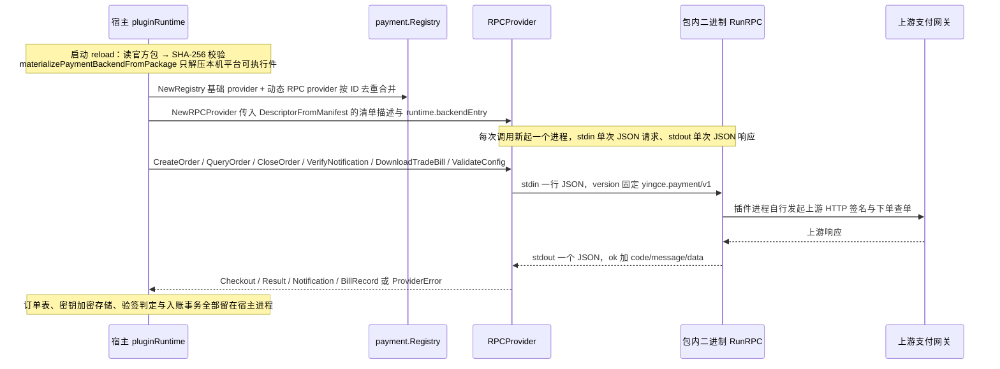
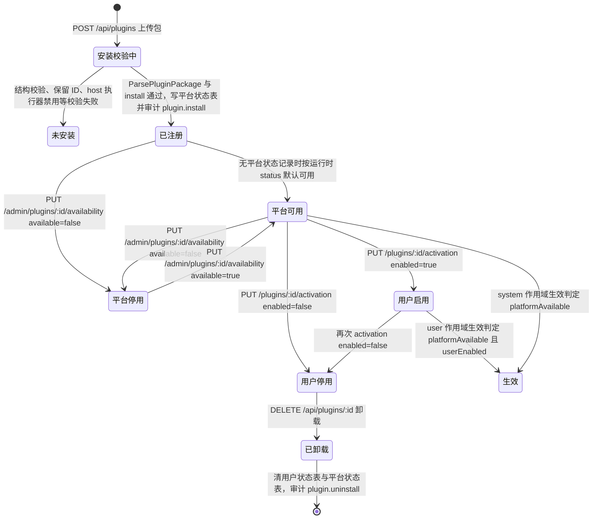

# 插件运行时细节：manifest 契约、支付 RPC 与生命周期状态机

本页是插件运行时的细节页：从 `backend/internal/protocol/types.go` 的 `Manifest`、`backend/internal/protocol/manifest.go` 的 `ValidateManifest` 与 `web/src/lib/plugins/plugin-types.ts` 的 `PluginManifest` 实证 manifest 契约字段；给出支付插件独立进程的 RPC 时序；画出安装—注册—启停—卸载的生命周期状态机。所有事实均经实地抽查核对。

## 一、manifest 字段枚举

manifest 是插件唯一能力契约（`types.go` 中 `Manifest` 结构注释原话：单契约，可同时贡献 providers、workflows、canvasNodes 等，运行时按贡献选执行引擎而不改公共形状）。线上格式在 `Manifest` 的 `MarshalJSON`/`UnmarshalJSON` 中平铺为顶层字段，经核实的字段如下：

| 字段 | 取值/类型 | 校验与语义（锚点=路径+符号） |
|---|---|---|
| `apiVersion` | `yingce.plugin/v1` 或 `yingce.plugin/v2` | `ValidateManifest`（`backend/internal/protocol/manifest.go`）只接受这两个字面量；前端 `plugin-types.ts` 常量 `PLUGIN_API_VERSION="yingce.plugin/v1"` 且类型放行 `"yingce.plugin/v2"`。实勘仓库 119 个官方包：114 个 v2、5 个 v1（v1 全部为支付包）。实勘两版并存（v2×114、v1×5，v1 全部为支付包），存量以 v2 为主 |
| `id` / `name` / `version` | wire 顶层平铺，内部投影为 `Metadata` | `validManifestIdentifier`：id 为小写字母/数字/`-`/`_`/`.`、≤96 字符、不得以 `-`/`_`/`.` 开头；name ≤160、author(vendor) ≤120；三者必填 |
| `entry` / `surfaces` | web 入口路径 / 表面枚举 | `validatePluginPackageRuntime`（`backend/internal/protocol/package.go`）：包内有 `web/` 文件或声明 `runtime.web` 时，entry 必填且必须位于 `web/` 内；surfaces 取值 node/fullscreen/hybrid/asset-source/settings/wallet（前端 `PluginSurface`） |
| `runtime` | `{backend, backendEntry, web}`（`ManifestRuntime`） | backend ∈ `declarative` / `rpc` / `wasm` / `trusted-backend` / `host:` 前缀（`ValidateManifest`）；上传件禁 `host:`（`pluginRuntime.install`）；`rpc`/`wasm` 的 `backendEntry` 必须相对 `backend/`，rpc 还须含任一平台可执行件（`HasAnyPaymentRPCBackend`）；上传含 web 文件时 `runtime.web` 必须 `sandbox` 或 `worker` |
| `permissions` | 枚举数组 | 前端 `PluginPermission`：canvas.read / canvas.write / asset.read / asset.search / asset.import / asset.upload / generation.run / ai.text / media.read / usage.read / payment.create / payment.query / payment.close / payment.reconcile / external.open |
| `configuration.fields` | `ManifestField[]` | name/type/label/required/secret/default/values；支付贡献的 `methodsField` 必须指向其中某个字段（`manifestHasConfigField`） |
| `contributes` | `ManifestContributions` | smsProviders / providers / paymentProviders / workflows / canvasNodes / transforms / commands / assetSources / usageObservers / aiCapabilities / agents / importExport；至少声明一项（`hasNonProviderContribution`） |

paymentProviders 贡献的字段（`ManifestPaymentProvider` + `validatePaymentProviderContributions`）：`id`/`label`/`icon` 必填且 id 全局唯一合法；`checkoutMode` 仅 `qr_code`/`redirect`；`expiryPolicy` 须 min ≤ default ≤ max 分钟且全为正；`identityFields` 每项 ≤80 字符；`notificationSuccess`/`notificationFailure` 的 status ∈ 0–599；`methods` 目录项 id 须过 `ValidPaymentMethodID`（≤32 位小写字母/数字/`-`/`_`）且不重复。

declarative 协议贡献的请求面在 `ManifestProvider`：`create` 必填，`agent`/`poll`/`cancel`/`result`/`upload` 可选；方法限 GET/POST/PUT/DELETE，路径必须相对（`isRelativePath`），Content-Type 限五种；另有 `imageParameters`、`videoModes`/`videoOutputs`、`requestBindings`、`validations`、`detachedPolling`、`idempotentCreate` 等校验。

**声明式 POST 路径白名单**：`backend/internal/app/system_proxy_protocol.go` 的 `SystemProxyContract.DeclaredPostPaths` 只在 `metadata.Execution == "declarative"` 时，从 `Metadata.Create`/`Metadata.Agent` 操作摘要中抽取 POST 路径，经 `systemProxyComparablePath` 去版本前缀与查询串后构成系统代理唯一放行清单；`backend/internal/handler/auth.go` 的 `authorizeSystemProxy` 用它拦截内置合同之外协议的任意路径与请求体。

**包容器约束**（`backend/internal/protocol/package.go`）：包格式 `yingce.plugin/package-v1`；整包 ≤48MB（`PluginPackageMaxBytes`）、manifest.json ≤512KB、≤256 文件、单条目 ≤16MB、禁符号链接；允许的包内根路径为 `manifest.json`、`web/`、`backend/`、`assets/`、`docs/` 前缀（指插件包内说明文件，非仓库目录）、`README.md`、`LICENSE`（`validatePluginPackagePath`）。`InspectPluginPackage` 在启动期只解压 manifest.json，执行期才全量解压并校验 SHA-256。

## 二、支付插件 RPC 时序

锚点链：manifest `contributes.paymentProviders` + `runtime.backendEntry` → `backend/internal/app/protocol_plugins.go`（`pluginRuntime.reload` 物化并构造 provider）→ `backend/internal/payment/registry.go`（`payment.Registry`）→ `backend/internal/payment/rpc.go`（`RPCProvider.call`）→ `backend/cmd/payment-*/main.go`（`paymentplugins.RunRPC`）。

单次 JSON RPC 合同（`rpc.go` 的 `pluginRPCVersion`/`pluginRPCMaxOutput`/`pluginRPCTimeout` 与 `rpcRequest`/`rpcResponse`）：版本字面量 `yingce.payment/v1`；stdout 上限 2MB；进程超时 30 秒；operation ∈ validate_config / create_order / query_order / close_order / verify_notification / download_trade_bill；回调验签时原文以 `bodyBase64` 传递；`ok=false` 时错误码映射宿主哨兵错误（如 `paymentsdk.RPCCodeOrderNotFound` → `ErrOrderNotFound`）。进程环境净化为 `PATH=/usr/bin:/bin`、`HOME=/nonexistent`（Windows 另保留 SystemRoot，`paymentPluginCommandEnv`）；启动前过 `validatePaymentExecutablePlatform` 的魔数与架构校验（ELF/Mach-O/PE）。

平台二进制解析：`backend/internal/protocol/payment_rpc.go` 的 `PaymentRPCBackendCandidates(entry, goos, goarch)` 生成 `entry-os-arch`、`目录/os-arch/base`、`entry` 及各自 `.exe` 变体候选；`rpc.go` 的 `ResolveRPCBackendPath` 逐个探测；落盘由 `protocol_plugins.go` 的 `materializePaymentBackendFromPackage` 完成（按摘要去重、跨进程硬链接复用、`.ready` 标记对应摘要）。实勘 `backend/internal/payment/registry.go` 只是 ID→Provider 的内存映射（`NewRegistry`/`Get`/`Descriptors`/`Providers`），平台解析与物化分别在 `PaymentRPCBackendCandidates`/`ResolveRPCBackendPath` 与 `materializePaymentBackendFromPackage`。

五个入口（均一行 `paymentplugins.RunRPC(provider, os.Stdin, os.Stdout)`，出错 `os.Exit(1)`；各目录只含 `main.go`）：

- `backend/cmd/payment-wechat/main.go` → `paymentplugins.NewWeChatProvider`
- `backend/cmd/payment-alipay/main.go` → 支付宝电脑网站支付
- `backend/cmd/payment-epay/main.go` → epay
- `backend/cmd/payment-xunhupay/main.go` → 虎皮椒聚合
- `backend/cmd/payment-zhifufm/main.go` → zhifufm

对应官方包 `official-payment-{wechat-native,alipay-page,xunhupay,zhifufm,epay}.yingce-plugin` 共 5 个，实勘均为 backend=`rpc`、apiVersion=`yingce.plugin/v1`、backendEntry=`backend/provider`。

**绝不回退宿主内置**：`backend/internal/app/payment_providers.go` 文件头声明"渠道实现全部来自已校验的支付插件包；没有可用插件时渠道列表为空，下单失败关闭，绝不回退到宿主内置实现"；`protocol_plugins.go` reload 段注释同样写明空注册表是有意的 fail-closed。

**现状观察**：`payment_providers.go` 的 `PaymentNotificationResponseFor` 构造空 `payment.NewRegistry()` 兑底（查不到 provider 时按 success 回退 204 或调用方给定的失败状态码）；全仓检索非测试代码未发现调用方，实际回调响应走 `Service.PaymentNotificationResponse` → `s.paymentRegistry`，该函数是空注册表兑底路径的残留。另注：`backend/internal/app/payment_plugins.go` 的 `bundledPaymentPluginManifests` 只保留微信/支付宝两个 `host:` 清单作为官方包缺失时的投影回退，虎皮椒/zhifufm/epay 仅有常量定义与包，无 bundled 清单。

## 三、生命周期状态机

关键转移的代码锚点：

- **安装**：`backend/internal/handler/plugin.go` `pluginRoutes.POST("")` → `RequireAdmin` → `http.MaxBytesReader` 48MB → `backend/internal/app/protocol_registry.go` `InstallPluginForAdmin`：官方应用/系统支付保留 ID 拒绝 → `pluginRuntime.install`（`protocol_plugins.go`）：上传件禁 `host:` 执行器（错误文案"上传插件不能使用宿主内置执行器"）、内置插件禁上传覆盖、请求插件同版本必须同 SHA-256（`retainRequestPackage`），包落盘为 `<sha256>.yingce-plugin` 后 reload；随后写 `model.PluginPlatformState` 并记审计事件 `plugin.install`。官方目录中的包同样禁 `host:`（bootstrap 期报"官方插件不能依赖 host 执行器"），`host:` 只允许代码内 bundled 清单引用。
- **已注册**：持久层为数据目录下 `plugin_registry.json`（`pluginRegistryRecord`：manifest 原文、source、packageSha256、`requestReleases` 历史、`withdrawn` 标记）；启动时 `bootstrapBuiltInPlugins` 将官方目录包与 bundled（工作流/支付/短信）清单对账，官方包是支付插件的可执行真源。启停状态分存两张表：`model.PluginPlatformState`（平台级）与 `model.UserPluginState`（用户级）。
- **平台级启停**：`PUT /admin/plugins/:id/availability` → `plugin_management.go` `SetPluginPlatformAvailability`：system 作用域且存在运行时时联动 `SetPluginEnabled`（改写 registry JSON 并 reload），随后 `SavePluginPlatformState` + 审计事件 `plugin.availability.update`；旧接口 `POST /plugins/:id/enable|disable`（`pluginToggle`）收敛到同一方法。
- **用户级启停**：`PUT /plugins/:id/activation` → `SetUserPluginEnabled`：仅 `ActivationScope == "user"` 允许（否则 Forbidden"系统插件只能由管理员统一管理"），且要求平台当前可用；写 `model.UserPluginState`。
- **生效判定**：`pluginStateForUser` —— user 作用域 `effective = platformAvailable && userEnabled`；system 作用域 `effective = platformAvailable`。前端镜像为 `web/src/stores/use-plugin-store.ts` 的 `isPluginEffectivelyEnabled`：serverState.effectiveEnabled → runtimeStatuses 中等于 "enabled" → 调用方 fallbackEnabled → 本地 installations.enabled。后端 `RequirePluginForUser` 按 `EffectiveEnabled` 统一拦截。
- **卸载**：`DELETE /api/plugins/:id` → `RequireAdmin` → `UninstallPluginForAdmin`（`protocol_registry.go`）：先 `ensurePaymentPluginCanBeRemoved`（有未完成支付订单禁卸），`pluginRuntime.uninstall` 内置插件禁卸、请求协议插件置 `withdrawn` 并保留包文件以便历史版本回验，最后 `repo.DeleteUserPluginStates` + `repo.DeletePluginPlatformState` 清两张状态表并记审计事件 `plugin.uninstall`。

### 现状观察

- **启停三重回退**：前端 `isPluginEffectivelyEnabled` 依次回退 serverState → runtimeStatuses → 本地 installations（调用方还可传 fallbackEnabled），不同加载时序下同一插件可能出现不一致的生效判定。
- **硬编码默认开启**：`plugin_management.go` `pluginStateForUser` 中，`media-conversion` 与 `user-feedback` 在用户从未保存个人选择时硬编码 `userEnabled = true`；`runninghub-workflow-provider` 未配置时回退运行时 status。
- **sandbox/worker 运行时未实现**：`web/src/components/canvas/canvas-node-content.tsx` `PluginCanvasNodeContent` 对 `renderer === "sandbox"` 只渲染"插件节点等待隔离运行时"占位；而 `package.go` 已强制上传含 web 文件的插件声明 `sandbox`/`worker`——合同先于实现。
- **硬编码 pluginId image-tools**：`web/src/pages/canvas/use-canvas-media-tools.ts` 节点 metadata 直接写死 `pluginId: "image-tools"`、`pluginNodeId: "annotation-edit"`。
- **bundled manifest 与 plugin-packages 双分发源**：官方应用同时来自仓库官方包目录与代码内 bundled 清单（工作流/支付/短信）；支付系统插件官方包优先、bundled 清单仅缺包回退（`bootstrapBuiltInPlugins`）。
- **官方应用 ID 前后端双份手工同步**：后端 `plugin_management.go` `officialApplicationPolicies` 维护 8 个 ID（official-asset-library、runninghub-workflow-provider、eagle-asset-connector、prompt-optimizer、portrait-clearance、ai-art-critique、media-conversion、user-feedback），前端 `web/src/lib/plugins/official-applications.ts` `OFFICIAL_APPLICATION_PLUGIN_IDS` 只有 5 个（缺 official-asset-library、portrait-clearance、media-conversion）；`web/src/lib/plugins/builtin/index.ts` 实际注册 7 个模块。两份清单靠人工保持一致。
