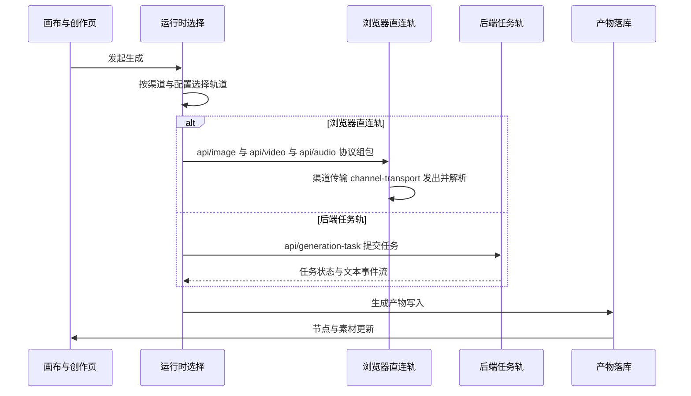

# 核心模块数据流与共享能力

本页是 [03 产品模块审计](../03-product-modules.md) 的行为层证据：三条核心数据流加模块间共享面，锚点为路径 + 符号名。

## 画布生成消费链（双轨分派）

- 轨道选择器：`web/src/lib/canvas/canvas-project-generation.ts` 与 `web/src/pages/create/creation-runtime.ts`（调用方自行决定走直连协议还是后端任务）。
- 直连轨协议组包：`web/src/services/api/image.ts`（image-protocols/image-streaming/image-response/image-validation 分件）、`api/video.ts`（video-provider-* 分派 + 轮询）、`api/audio.ts`；传输统一走 `channel-transport.ts` 与 `custom-channel-relay.ts`（自定义渠道改写后端中转）。
- 任务轨：`web/src/services/api/generation-task.ts`（runBackendGenerationTask / parseBackendGenerationTask）。
- 产物落库与消费：`web/src/services/` 的 generation-artifact-sink、generation-asset-repository、generation-completion-tracker、generation-consumer-dedupe/lifecycle、generation-task-materializer、provider-neutral-generation-effects。

## 任务中心与 Agent 事件流

- 任务中心：`web/src/services/api/task-center.ts` 自维护 `lastEventId` 游标并以 `?after=` 续传（SSE 消费点一）。
- Agent 流：`web/src/services/api/agent.ts` 以请求头 `Last-Event-ID` 续传并校验 `text/event-stream` 内容类型（消费点二）。
- 解析器共用：`web/src/services/api/task-text-stream.ts`（consumeTaskTextStream）；本地运行时另有 `web/src/services/local-runtime-session.ts` 处理 last-event-id。
- 游标语义：事件 id 递增，断线用 `Last-Event-ID` 或 `?after=` 续传，不把任务 ID 当游标。

## 模块间共享能力

- **素材库共享族**：`web/src/services/` 的 user-data-sync、user-data-sync-media、project-asset-sync、creation-history-sync 与媒体缓存族（image-storage、file-storage、resource-blob-cache、local-media-object-urls）支撑画布、创作页、电商、团队空间共用素材；面板层复用 `pages/assets/` 的 asset-library-panels。
- **模型选择与参数面板**：`web/src/components/` 的 model-picker、image-settings-panel、audio-settings-panel、media-preview、model-editor-modal 跨页复用。
- **任务中心聚合**：task-center API 与事件流为全局任务状态唯一入口。

## 电商工作台

- `web/src/pages/ecommerce/`（约 60 文件）：营销图整套生成工作流；路由 `/ecommerce` 仅 `RequireAuth`。
- 管理侧配置在 `/admin/ecommerce/agent` 与 `/admin/ecommerce/library`（知识与技能），旧地址已重定向（见 [路由清单](03-route-inventory.md)）。

## 短剧项目

- `web/src/pages/projects/` + `studio/`（约 35 文件）：按项目与分集组织制作流程；`/projects/:projectId/*` 兜底重定向回项目路由。
- 后端短剧域路由挂 `RequireFeature(svc, service.FeatureShortDrama)`（`backend/internal/handler/api.go` 注册处分组），前端经功能开关联动。

## 审计观察（现状事实）

1. 双轨生成由调用方自行选择，两条轨的产物写入与状态更新路径不同（见画布链的 alt 分支），是行为一致性的主要审计面。
2. 画布同步三轨并存：canvas-realtime（实时订阅）+ canvas-sync-polling（轮询）+ canvas-mutation-batches / canvas-edit-leases（写侧协调），读侧与写侧各自独立演进。
