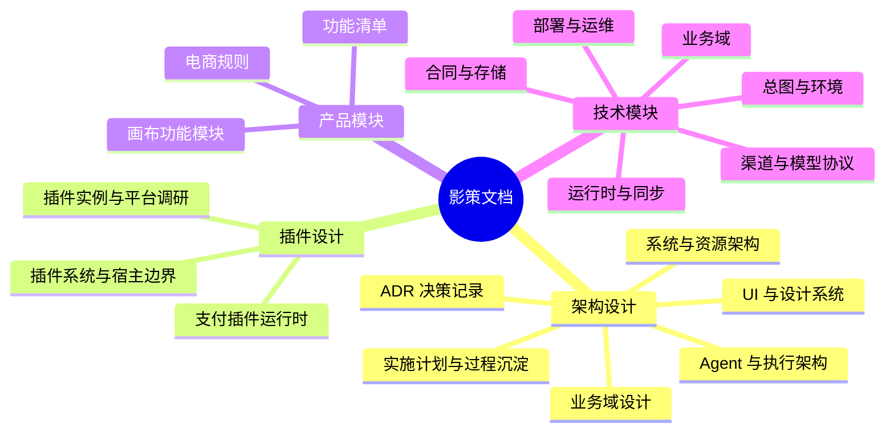

# 影策 · 文档索引

影策（`ddcat-ai/open-ai-canvas`）是面向 AI 影视与短剧创作的工作台。本页是仓库文档的唯一入口地图：先总览、后下钻；每篇文档只收录一次，细节以文档自身为准。维护规则见 [AGENTS.md](../AGENTS.md) 第 9 节「文档与交付」。

## 总览

文档状态沿用各篇自述，分四档：已实现 / 提案未实施 / 调研建议 / 历史归档。

## 一、架构设计文档

系统级架构、协议与设计合同；改动边界和验收门槛以各篇自述为准。

### 系统与资源架构

- [资源访问与 OSS/CDN 分发架构重构](design/resource-delivery-architecture.md)：资源身份、场景授权与分发策略分离，统一访问合同、全入口迁移、旧实现退场及流量/安全验收门槛（核心代码已实施，待真实 OSS/CDN 链路验收）。
- [画布性能与媒体分发最终改造方案](design/canvas-final-performance-architecture.md)：基于现有 OSS/CDN 重构的最终目标与一次性改造边界，已具备能力不重复建设。
- [服务动态更新设计](design/dynamic-update.md)：自托管实例后台受控升级：单一更新任务、可恢复备份、迁移失败不启动、健康检查失败自动回滚。
- [LLM、Image、Video 主流请求协议全景与影策兼容性调查](design/model-request-protocol-landscape.md)：主流原生协议、聚合网关、图片/视频异步任务、参考素材 role、当前插件映射缺口与 MiniMax H3 专项审计（调研）。
- [多平台账号池最终指导方案](design/account-pool-design.mdx)：通用账号池框架、平台适配标准 `yingce.accountpool/v1`、独立适配服务、扫码添加账号与多档位调度（最终指导方案，未实施）。
- [云端 Agent 架构优化方案](design/cloud-agent-architecture-optimization.md)：跨端生成合同、引用绑定、审批依赖、报价预算、运行存储与工作上下文的现状审查与分阶段方案（提案，未实施）。
- [用户诊断包设计](design/user-diagnostic-bundle.mdx)：面向普通用户的一键日志导出、前后端链路关联、脱敏、权限与排障方案。

### Agent 与执行架构

- [Agent 浏览器 Worker 与服务端共存](design/browser-agent-worker.md)：默认关闭的环境变量与后台开关、单步授权、断线续跑和失败日志自动上报（已实现，完成本地联调）。
- [浏览器 Agent 改造计划审计](design/browser-agent-worker-audit.md)：对浏览器 Agent 改造计划的实施审计记录。
- [yingce-bridge 多设备本地执行架构](design/yingce-bridge-architecture.md)：Web 主产品 + 本地执行代理；账号设备绑定、能力发现、ComfyUI/Ollama/CLI/MCP 适配、本机权限与多设备调度（提案，未实施）。
- [yingce-bridge 断连、恢复与分布式执行可靠性](design/yingce-bridge-reliability.md)：Chubby/RIFL/Sagas/Ray/Beldi 论文与 Temporal/Kubernetes/KubeEdge 对照；启动授权、有限离线执行、账本核对与故障注入矩阵（研究与协议提案，未实施）。

### 业务域设计

- [团队空间、积分划拨与素材共享](design/team-workspace-design.md)：自由画布、创作页和素材库在个人与团队之间复用，按空间隔离作品与费用。
- [短信渠道插件与登录注册策略](design/sms-channels-and-auth-policy.md)：阿里云/腾讯云 SDK 候选基线、多渠道与模板路由、验证码安全及登录注册组合（核心代码已实施）。
- [画布批量生成一致性治理](design/canvas-consistency-repair.mdx)：节点丢失、批次状态与引用解析的根因、已实施边界重构、回归证据和待验收场景。
- [生图与视频方案](design/image-video-workbench-solution.md)：独立生图/视频入口、后台工作台工具管理（目录、预设、示例）与功能开放开关。
- [短剧拆镜与段间连续性调研](design/short-drama-shot-continuity-research.md)：对照制作台、同类产品和公开 Skill，区分同镜续拍、同场换镜与换场，附真实样片回查方法（调研建议，未实施）。
- [角色卡梳妆台功能规格](design/character-dressing-table-spec.md)：六类参考资产、官方配置与姿势库复用、统一图片任务与命名保存（核心已实现并完成本地主链路验收；使用入口见[角色梳妆台](content/docs/canvas/character-dressing-table.mdx)）。

### UI 与设计系统

- [站点及外观与皮肤主题设计合同](design/site-appearance-and-skins.mdx)：品牌一致性、登录页与邮件、SEO/备案、三层皮肤令牌、无闪屏启动顺序和验收边界。
- [UI 皮肤库架构设计](design/ui-skin-library.mdx)：Foundation 固定尺度与可换肤层分离、皮肤清单格式、OKLCH 颜色推导与校验规则（提案，未实施）。
- [工作区外壳设计沉淀](design/workspace-shell-design.mdx)：侧栏（可折叠导航 + 分组折叠）、主区卡片、顶部栏的设计决策与样式约束。
- [画布节点可读性设计沉淀](design/canvas-node-visual-contrast.mdx)：节点外壳、空态和图片创作面板在明暗画布上的表面、边界、阴影与控件状态约束。
- [画布浮动控件设计沉淀](design/canvas-floating-controls.mdx)：顶部操作区、底部 Dock、小地图和工作模式切换的浮动面板、定位与响应式约束。
- [影策品牌首页](design/story-creation-homepage.md)：六幕电影卷轴、公开入口、故事素材、工作台预览与响应式降级。
- [管理后台 UI 与布局规范](design/admin-ui-design-standard.md)：后台与用户端的隔离合同——Token 源、控件主题与壳层组件边界（现行约束）。
- [管理后台 UI 变更记录](design/admin-ui-change-log.md)：后台 UI 的实际变更记录。
- [管理后台 PC 视觉回归基线](design/admin-ui-visual-regression-baseline.md)：后台视觉回归的适用范围与基线。

### 决策记录（`docs/adr/`）

ADR-0001～0007 的站内手工剪辑方案已随产品减负退场，保留为历史决策；不再据此新增剪辑能力。

- [ADR-0001：编辑器整合边界](adr/0001-editor-integration-boundary.md)：以 TS 时间线状态机为真相源，不移植 Rust 引擎；媒体重活放 Go 后端。
- [ADR-0002：编辑命令协议](adr/0002-edit-command-protocol.md)：时间线唯一修改入口为可序列化编辑命令，手势 echo、有界快照撤销、防抖保存。
- [ADR-0003：预览与导出分层](adr/0003-preview-export-layering.md)：交互近似预览 + 单一滤镜图计划驱动导出，禁止手写第二套滤镜串。
- [ADR-0004：自动字幕转写服务化](adr/0004-autocaption-transcription-service.md)：转写为 Go 后端异步任务，结果写回字幕轨道。
- [ADR-0005：编辑器预设插件架构](adr/0005-editor-preset-plugin-architecture.md)：编辑器全部 UI 与能力为预设插件贡献，插件 SDK 演进为 v2。
- [ADR-0006：语音滤镜与项目模板](adr/0006-voice-filters-and-templates.md)：语音滤镜走 Web Audio 预览近似 + ffmpeg 音频滤镜图导出，模板走项目快照服务化。
- [ADR-0007：AI 编辑交互](adr/0007-ai-editing-interaction.md)：AI 输出受约束命令 JSON（schema 校验 fail-closed），与手势命令同队列同撤销栈。
- [ADR-0008：自研 UI 组件层与 AntD 替换](adr/0008-ui-component-layer-antd-replacement.md)：`components/ui` 重建为自研 Celadon UI，分阶段替换 AntD 并最终脱离。
- [ADR-0009：媒体产出模型与选用模型分开记录](adr/0009-produced-model-separate-from-selection.md)：生成成功时冻结产出模型，选用模型继续随下拉变化。
- [ADR-0055：图片参数声明与生成合同](adr/0055-image-parameter-contract.md)：图片参数的声明、校验与生成合同。

### 实施计划与过程沉淀（`docs/plans/`、`docs/superpowers/`）

过程性文档：排期、审计与交接记录，读者是需要继续执行的协作者；产品事实以上面三类文档为准。

- [Celadon UI 组件规范](plans/ui-design-system.mdx)：长期维护的组件编写规范与 backlog（活规范）。
- [Celadon UI 自研组件层实施计划](plans/ui-kit-rollout-plan.mdx)：AntD 替换的唯一实施计划。
- [BoardUI 吸收整合方案](plans/boardui-absorption-plan.mdx)：吸收 BoardUI 设计深度的来源归属与整合步骤。
- [UI-kit 消费一致性审计报告](plans/ui-kit-consumption-audit.md)：页面 × 管理后台的控件残留审计。
- [首页对话区优化计划](plans/home-chat-optimization-plan.mdx)：两个阶段的执行顺序与代码高亮方案。
- [M4 转写与渲染任务设计](plans/m4-transcription-render-design.md)：转写与渲染任务已按实现回写；出入以后端现行代码为准。
- [电商创作体验改造方案](plans/ecommerce-workbench-redesign.md)：商品记忆、整套内容规划与逐张迭代（产品与交互提案，未实施）。
- [电商创作工作台改造交接文档](plans/ecommerce-handoff.md)：改造的需求、进度与待落地项交接。
- [分享会待办方案调研](plans/share-meeting-todo-research-plan.md)：基于当前源码核对的调研方案，供排期拆分。
- [零价免费模型设计](superpowers/specs/2026-08-24-zero-price-models-design.md)：价格档为 0 时的免费模型可见性与不扣减积分。
- [统一异步视频轮询容错设计](superpowers/specs/2026-09-12-unified-video-polling-design.md)：所有异步视频协议统一轮询间隔与瞬时失败容错。
- [第三方画布导入同步修复计划](superpowers/plans/2026-11-03-libtv-import-sync.md)：导入超时后保留已提交节点、不误报保存成功。
- **历史归档，停止实施**：[编辑器预设插件化实施规格](plans/editor-preset-plugin-implementation.md)。
- **历史归档，停止实施**：[编辑器实施 Runbook](plans/editor-implementation-runbook.md)。

## 二、插件设计文档

- [插件系统设计](content/docs/plugins/plugin-system.mdx)：插件分类、包与清单、宿主 API 边界、生命周期与安全边界、开发者接入流程（系统设计主文档）。
- [插件显示形态](content/docs/plugins/plugin-surfaces.mdx)：插件在产品中的展示面。
- [支付插件运行时](content/docs/plugins/payment-plugin-runtime.mdx)：支付插件双架构的运行时边界。
- [AI 审美批改画布插件](content/docs/plugins/ai-art-critique.mdx)：已实现功能文档。
- [AI 审美批改画布插件方案](design/ai-art-critique-solution.md)：云端视觉分析、并行 Reviewer、问题定位与前端 SVG 标注的职责边界（设计稿）。
- [插件平台与市场演进调研](design/plugin-platform-and-marketplace-research.md)：插件机制代码审计、外部 SDK 与隔离运行时、受控目录到公开市场的分阶段方案（调研建议，未实施）。

## 三、产品模块文档

- [功能清单](content/docs/overview/features.mdx)：全部产品模块与能力的总目录（产品文档总入口）。
- [角色梳妆台](content/docs/canvas/character-dressing-table.mdx)：六类参考资产、个人分类入口、统一图片任务与角色形象保存。
- [姿势库](content/docs/canvas/pose-library.mdx)：站点姿势库的使用入口。
- [电商平台风格与图片规则](content/docs/overview/ecommerce-platform-rules.mdx)：电商创作的平台约束与图片规则。

## 四、技术模块文档（按依赖次序编号）

编号即建议阅读次序，按依赖方向排列——被依赖者在前：总图与环境 → 合同与存储 → 渠道与模型协议 → 运行时与同步 → 业务域 → 部署与运维。后端依赖方向为 `HTTP -> handler -> service -> app（组合根）-> 业务域包 -> repository/model -> database`；前端为 `pages -> components -> stores -> services -> lib`。

### 总图与环境

- **01** [代码功能地图](content/docs/backend/code-map.mdx)：前后端模块、调用链与域包依赖方向；技术文档总入口。
- **02** [本地开发](content/docs/backend/local-development.mdx)：宿主机后端、Agent runtime 安装与热更新开发环境。

### 合同与存储

- **03** [HTTP API 合同](content/docs/backend/http-api.mdx)：统一响应信封、错误码、鉴权与各域接口合同。
- **04** [后端数据库](content/docs/backend/backend-database.mdx)：表结构、Schema 演进与迁移事实；字段变化必须同步此文档。

### 渠道与模型协议

- **05** [渠道、模板与批量配置](content/docs/backend/channel-configuration.mdx)：模型渠道与媒体参数的数据基座。
- **06** [官方视频模型与插件版本](content/docs/backend/official-video-protocols.mdx)：官方渠道视频协议与插件版本管理。
- **07** [NewAPI Video Generations Channel 2](content/docs/backend/newapi-channel-2.mdx)：NewAPI 聚合渠道协议。
- **08** [百炼 MiniMax 视频](content/docs/backend/bailian-minimax-video.mdx)：百炼渠道视频接入。
- **09** [MiniMax H3 图片](content/docs/backend/minimax-h3-image.mdx)：MiniMax H3 图片协议。
- **10** [MiniMax 语音合成](content/docs/backend/minimax-speech.mdx)：MiniMax 语音协议。
- **11** [EvoLink 音频模型](content/docs/backend/evolink-seed-audio.mdx)：EvoLink/SeedAudio 音频协议。
- **12** [相对深度视频](content/docs/backend/video-depth.mdx)：深度视频生成任务。

### 运行时与同步

- **13** [任务缓存与队列稳定性](content/docs/backend/task-runtime-stability.mdx)：异步任务、worker 与文本 SSE 的运行时保障。
- **14** [画布 operations 同步协议](content/docs/backend/canvas-operations-sync.mdx)：多窗口实时协作的操作同步合同。

### 业务域

- **15** [微信网站应用登录](content/docs/backend/wechat-login.mdx)：登录注册域（`internal/auth`）。
- **16** [Agent MCP 连接与市场](content/docs/backend/agent-mcp.mdx)：Agent 的 MCP 连接与市场。
- **17** [后台管理 MCP 与 Skill](content/docs/backend/admin-assistant.mdx)：管理后台 Agent 的接入与技能。
- **18** [画布 Agent 提示词与用户意图](content/docs/backend/agent-prompt-policy.mdx)：提示词域（`internal/prompts`）策略。
- **19** [技能策展](content/docs/backend/skill-curation.mdx)：技能库域（`internal/skills`）。
- **20** [画布 Agent 外观与形象](content/docs/backend/canvas-agent-appearance.mdx)：助手名称、文案模板与 Live2D 模型包边界。
- **21** [电商 Agent 与后台知识库](content/docs/backend/ecommerce-agent.mdx)：电商连续创作与知识库。
- **22** [注册与签到积分赠送](content/docs/backend/credit-rewards.mdx)：积分账本基础。
- **23** [图片用量计费](content/docs/backend/image-usage-billing.mdx)：建立在渠道与任务之上的图片计费。
- **24** [视频 Token 计费](content/docs/backend/video-token-billing.mdx)：视频任务 Token 计费。
- **25** [自定义更新公告](content/docs/backend/update-announcements.mdx)：公告内容管理。

### 部署与运维

- **26** [在线更新与安全回退](content/docs/backend/system-update.mdx)：受管部署条件、安装、备份、迁移和回退。
- **27** [仅浏览器 Agent 部署](content/docs/overview/browser-agent-deployment.mdx)：停用 Node Agent 容器、受管安装与更新、浏览器运行边界。

## 进度与本地协作

- [待测试](content/docs/progress/pending-test.mdx)：已实现但未由用户确认的变化先记录于此。
- beautifului 创作设计：本地设计参考，不随仓库分发，仓库内无对应文件。
